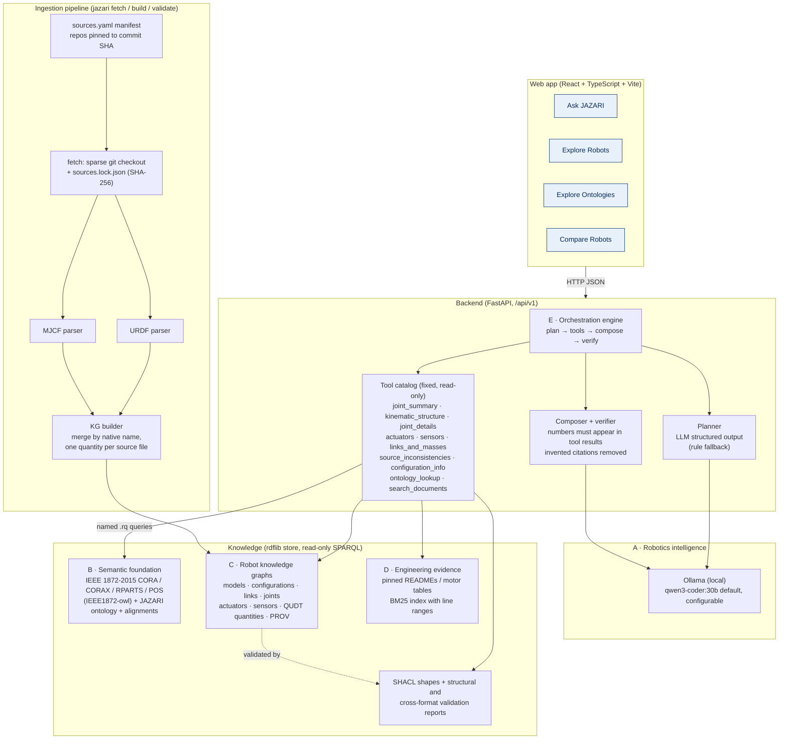

# JAZARI architecture overview

JAZARI is a hybrid neuro-symbolic robotics expert. Facts live in explicit, versioned
knowledge (ontologies, a robot knowledge graph, pinned documents). A local LLM only plans
which read-only tools to call and phrases the answer. Arithmetic is done in Python, never
by the model.

## Diagram

## Request flow (Ask JAZARI)

1. **Plan.** The question, the tool catalog, the configurations in the graph and the
   conversation context are sent to the LLM with an Ollama JSON schema whose `name` field
   is an enum of tool names. The model can only choose from the catalog. If Ollama is not
   reachable, a deterministic keyword planner is used instead, and the response says so.
2. **Execute.** Each tool runs named SPARQL queries from
   [`knowledge-graphs/queries/`](../../knowledge-graphs/queries). Parameters are passed as
   SPARQL bindings, never spliced into query text. The store accepts only `SELECT` and
   refuses `SERVICE`. Counts, sums and chain extraction happen in Python, and each tool
   records how it derived them (`derivations`).
3. **Evidence.** Tools return evidence items typed as `extracted`, `derived`, `inferred`,
   `document`, `ontology` or `validation`. Each item carries a GitHub permalink to the exact
   file revision, and to the exact line where possible. The engine numbers them `E1…En`.
4. **Compose.** The LLM writes the answer from the tool facts only and cites `[E#]`.
5. **Verify.** Every number in the answer is checked against the tool results.
   Unsupported numbers are flagged in the UI. Bracketed citations that don't match a real
   evidence id are removed.
6. **Trace.** The response includes the planner used, every tool call, its SPARQL, its row
   count, its derivations and its latency. The UI shows these under "How JAZARI answered".
   It never shows chain-of-thought.

Follow-up questions keep the session's robot configuration, so "its left knee" resolves
to the G1. A robot that is named but not in the graph is never answered with another
robot's data.

## Knowledge model in one paragraph

A `jz:RobotModel` (Unitree G1) has `jz:RobotConfiguration`s (G1 29-DoF rev 1.0). Both are
`corax:Design`s, because a URDF or MJCF file describes a design, not a physical unit.
Configuration elements (`jz:Link`, `jz:Joint` and subclasses, `jz:Actuator`, `jz:Sensor`)
are `corax:DesignObject`s. Each element has one `jz:SourceMention` per file that describes
it (file, line, type as written there). Each engineering quantity is a
`qudt:QuantityValue` with unit, source file, source line, source attribute and evidence
type. A URDF value and an MJCF value for the same limit are therefore stored side by side,
never merged, and disagreements show up in validation. Physical robots
(`jz:RobotInstance ⊑ cora:Robot`) are kept separate and are not populated yet. The
[ontology notes](../ontology/reference-ontologies.md) give the full rationale.

## Code map

| Area | Path |
|---|---|
| Source manifest and lock | `knowledge-graphs/manifests/` |
| Named SPARQL queries | `knowledge-graphs/queries/*.rq` |
| JAZARI ontology, alignments, SHACL | `ontology/jazari`, `ontology/alignments`, `ontology/validation` |
| Fetch, parse, build, validate | `backend/jazari/{fetch,ingestion,kg,validation}.py` |
| Tools, planner, composer, engine | `backend/jazari/intelligence/` |
| Prompts | `backend/jazari/intelligence/prompts/` |
| HTTP API | `backend/jazari/api/app.py` |
| Benchmark and runner | `evaluation/benchmark.yaml`, `backend/jazari/evaluation.py` |
| Web app | `frontend/src/` |

## Replaceability

- **LLM:** `JAZARI_MODEL` and `JAZARI_OLLAMA_URL` select the model. Only
  `OllamaClient.chat` is model-specific. Knowledge is unaffected by a model swap.
- **Graph store:** `GraphStore.select()` is the only query entry point. It can be backed
  by Apache Jena Fuseki once a persistent SPARQL service is needed.
- **Ontologies:** reference modules are loaded from the pinned checkout. Changing the
  pin and re-running `jazari build && jazari validate` updates them without UI changes.
- **Robots:** adding a configuration to `sources.yaml` and running the pipeline grows
  the graph without retraining anything.
