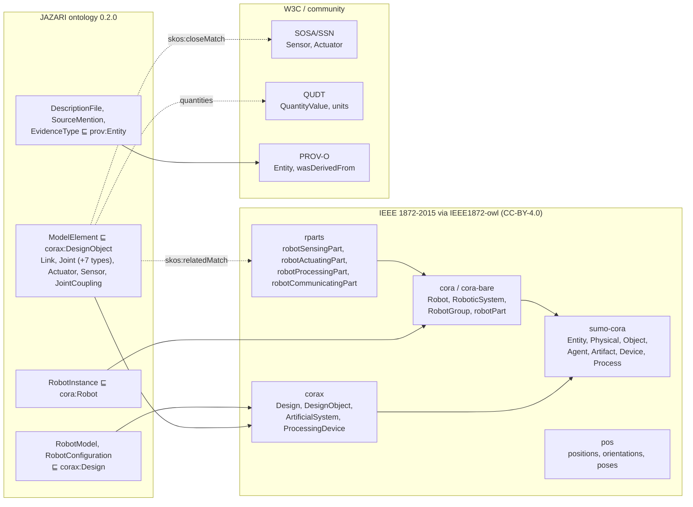

# Reference ontologies

JAZARI reuses existing ontologies wherever they cover a concept and adds its own terms only
where they don't. This page records what was evaluated, what is reused, and the gaps.

## Ontology map

## Evaluated ontologies

| Ontology | Governing body / version | Canonical URI | License | Use in JAZARI | Concepts reused | Gaps |
|---|---|---|---|---|---|---|
| **CORA** (IEEE 1872-2015) | IEEE RAS; OWL by Fiorini et al., commit `ffb6613` | `http://purl.org/ieee1872-owl/cora` | CC-BY-4.0 (OWL); standard text © IEEE | **Loaded**, top-level robot notions | `Robot`, `RoboticSystem`, `SingleRoboticSystem`, `CollectiveRoboticSystem`, `RobotGroup`, `RobotInterface`, `robotPart`, autonomy properties | No kinematics; no NL definitions in OWL |
| **CORAX** | same | `…/corax` | CC-BY-4.0 | **Loaded**, design vs artifact | `Design`, `DesignObject`, `ArtificialSystem`, `ProcessingDevice`, `dependsOn`, `designMeasure` | — |
| **RPARTS** | same | `…/rparts` | CC-BY-4.0 | **Loaded**, part roles | `robotSensingPart`, `robotActuatingPart`, `robotProcessingPart`, `robotCommunicatingPart` (with IEEE axiom numbers 8.x) | Roles only, no part taxonomy |
| **POS** | same | `…/pos` | CC-BY-4.0 | **Loaded**, not yet used | — | Pose of links/joints planned (M4) |
| SUMO subset (`sumo-cora`) | same | `…/sumo-cora` | CC-BY-4.0 | **Loaded** (upper ontology required by CORA) | `Device`, `Agent`, `Artifact`, `Process` | — |
| **IEEE 1872.2-2021 (AuR)** | IEEE RAS | — | standard © IEEE; no openly licensed OWL found | Not loaded | — | Revisit if an open OWL release appears |
| **SOSA/SSN** | W3C/OGC Rec. 2017 (2023 ed.) | `http://www.w3.org/ns/sosa/` | W3C Document License | Mapping target only (SKOS) | `sosa:Sensor`, `sosa:Actuator` | Observation model used once sensor data arrives |
| **QUDT** | QUDT.org 2.1 | `http://qudt.org/schema/qudt/` | CC-BY-4.0 | **Used** for all quantities | `QuantityValue`, `numericValue`, `unit`; units `RAD`, `M`, `KiloGM`, `N-M`, `N`, `RAD-PER-SEC`, `M-PER-SEC` | Vocabulary not loaded (IRIs only); unit checks via SHACL `sh:in` |
| **PROV-O** | W3C Rec. 2013 | `http://www.w3.org/ns/prov#` | W3C Document License | **Used** for provenance | `prov:Entity`, `prov:wasDerivedFrom` (via `jz:describedIn`) | — |
| OWL-Time | W3C | `http://www.w3.org/2006/time#` | W3C | Not used | — | No temporal use case yet |
| KnowRob/SOMA URDF ontology | IAI Bremen | — | check before use | Candidate for joint/link alignment | — | Evaluate in M4 |

## JAZARI extension

File: [`ontology/jazari/jazari.ttl`](../../ontology/jazari/jazari.ttl), version 0.2.0,
namespace `https://w3id.org/jazari/ontology#`.

Model, configuration and instance are kept distinct:

| Notion | JAZARI class | Superclass | Example |
|---|---|---|---|
| Product line | `jz:RobotModel` | `corax:Design` | Unitree G1 |
| Variant / configuration | `jz:RobotConfiguration` | `corax:Design` | G1 29-DoF rev 1.0 |
| Physical unit | `jz:RobotInstance` | `cora:Robot` | (none yet) |

Joint classes and DoF table: `RevoluteJoint`, `ContinuousJoint`, `PrismaticJoint` (1),
`BallJoint`, `PlanarJoint` (3), `FloatingJoint` (6), `FixedJoint` (0). The source type as
written (`revolute`, `hinge`, `free`…) is kept on each `jz:SourceMention`.

Evidence types (`jz:EvidenceType`): `Extracted`, `Derived`, `Inferred`, `Curated`.

Added in 0.2.0 (M3):
- `jz:JointCoupling`, with `jz:dependentJoint`, `jz:independentJoint` and
  `jz:polynomialCoefficients`, for MJCF `<equality><joint>` (ALOHA grippers)
- actuator hardware facts from `ros2_control`: `jz:actuatorModel`, `jz:hardwareAddress`,
  `jz:hardwarePlugin`, `jz:commandInterface`, `jz:transmissionType`,
  `jz:transmissionParameters`, and `jz:currentLimit` (QUDT ampere). There is also `jz:mjcfKp`
- `jz:effortLimit` no longer has a joint-only domain: actuators state force limits too
- `jz:sensorDetail` for camera attributes, and `jz:xacroArguments` on Xacro files
- an MJCF body without a joint is a `jz:FixedJoint` with source type `weld`

## Class and property mapping table

| JAZARI | Relation | Reference | Note |
|---|---|---|---|
| `jz:RobotModel`, `jz:RobotConfiguration` | `rdfs:subClassOf` | `corax:Design` | design-level |
| `jz:ModelElement` | `rdfs:subClassOf` | `corax:DesignObject` | links, joints, actuators, sensors |
| `jz:RobotInstance` | `rdfs:subClassOf` | `cora:Robot` | physical robots |
| `jz:Actuator` | `skos:closeMatch` / `skos:relatedMatch` | `sosa:Actuator` / `rparts:robotActuatingPart` | not subclassing: design ≠ device |
| `jz:Sensor` | `skos:closeMatch` / `skos:relatedMatch` | `sosa:Sensor` / `rparts:robotSensingPart` | idem |
| `jz:hasElement` | `rdfs:subPropertyOf` | `corax:dependsOn` | |
| `jz:describedIn` | `rdfs:subPropertyOf` | `prov:wasDerivedFrom` | |
| quantities | range | `qudt:QuantityValue` | |
| `jz:Link`, `jz:Joint` | — | *no IEEE 1872 counterpart* | documented gap |

## Quality checks

`jazari validate` runs:

- **SHACL** ([`ontology/validation/shapes.ttl`](../../ontology/validation/shapes.ttl)) with
  RDFS inference over the loaded ontologies. It checks required provenance on every
  element and quantity, joint connectivity cardinalities, the DoF range, allowed QUDT
  units, `xsd:double` values, positive masses, 40-hex commit pins and 64-hex SHA-256.
- **Structural checks:** missing link references, duplicate identifiers, tree property (one
  parent per link), cycles, disconnected links, actuators pointing to missing joints, and
  at most one value per quantity per source file.
- **Cross-format checks:** the same limit in URDF vs MJCF (relative tolerance 1e-4), unit
  mismatches, and values stated in only one format.
- **Parsing tests:** all `.ttl` files parse, and all named `.rq` queries compile as
  read-only SPARQL.

Current results:

| Configuration | SHACL | Structural errors | Cross-format inconsistencies | Stated in one format only |
|---|---|---|---|---|
| G1 29-DoF rev 1.0 | conforms | 0 | 6 (effort limits, URDF 35 vs MJCF 50 N·m) | 29 (velocity limits) |
| Berkeley `lite` | conforms | 0 | 0 | 72 (velocity limits) |
| Berkeley `lite_biped` | conforms | 0 | 0 (Xacro torque limits = MJCF forcerange) | 28 (velocity and current limits) |
| ALOHA 2 | conforms | 0 | — (single format) | — |
